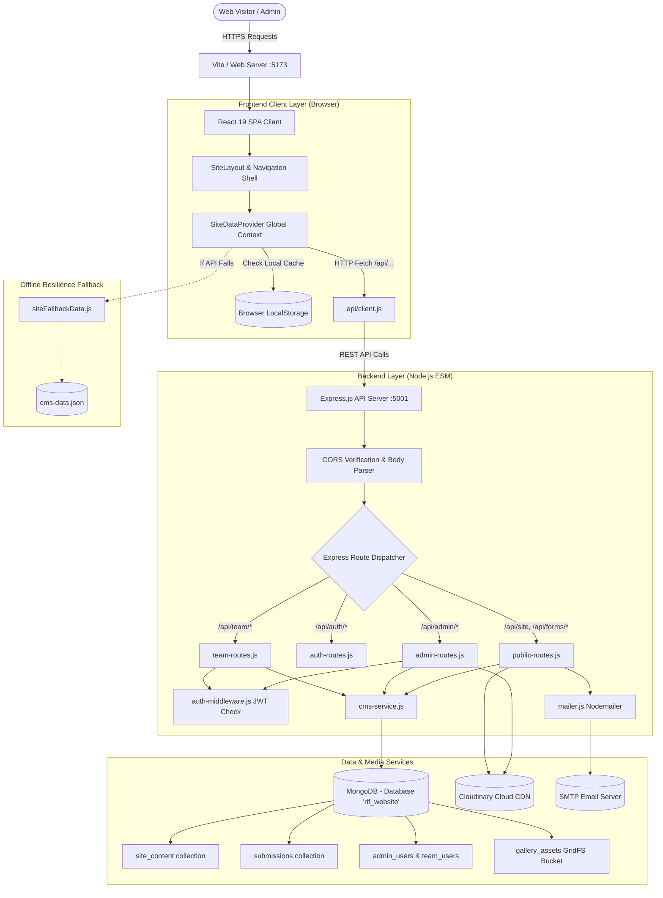
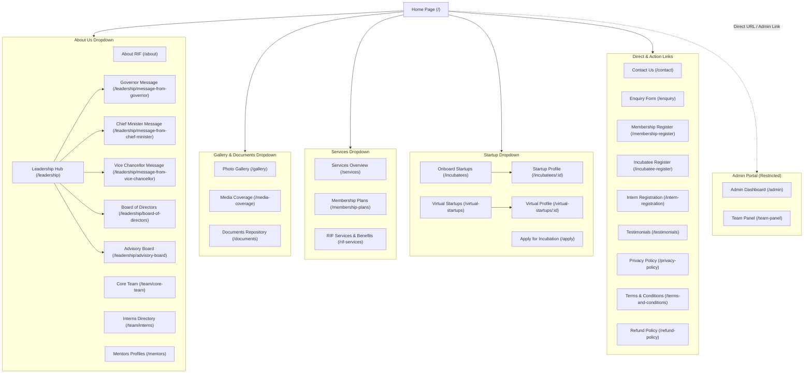
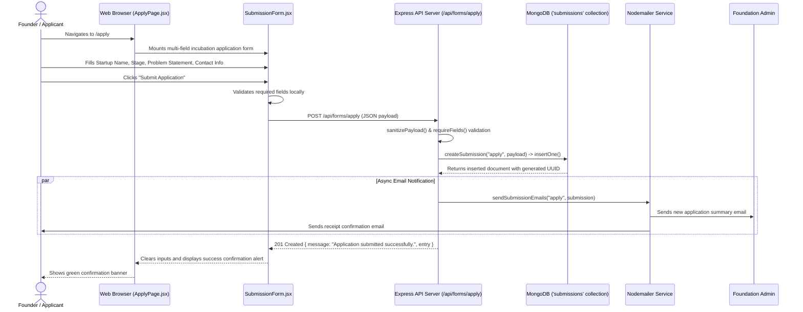
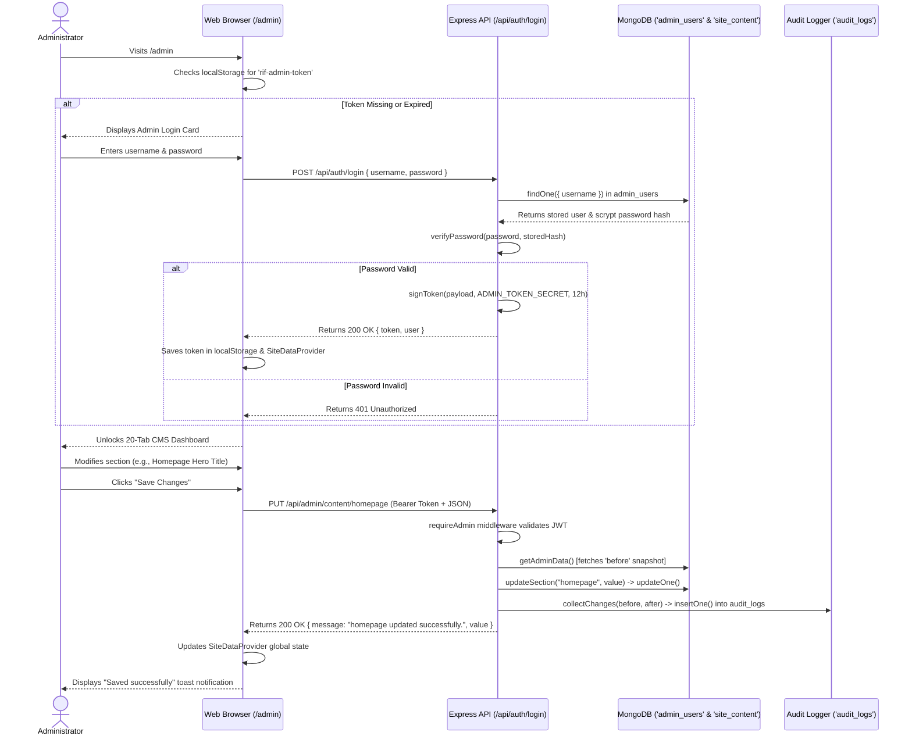
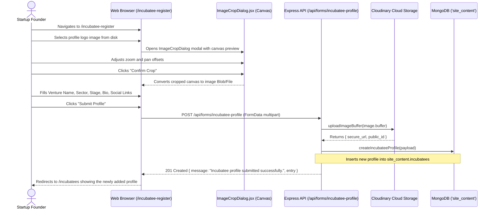

# RIF Website — Architecture & Flow Diagrams

This document illustrates the structural architecture, page-to-page navigation topology, and major end-to-end user flows of the RIF web platform using Mermaid diagrams.

---

## 1. Overall System Architecture

### Explanation of Architecture
1. **Visitor Requests:** The visitor browser loads the React single-page application bundle from the host server.
2. **Context Initialization:** `SiteDataProvider` initializes state from browser local storage, then makes an asynchronous call to `/api/site`. If the backend or database is unreachable, it seamlessly falls back to bundled JSON data (`cms-data.json`).
3. **Backend Middleware Pipeline:** The Express server validates CORS origin rules, parses incoming JSON payloads, and directs requests to appropriate routers.
4. **Administrative Protection:** Admin and team endpoints are protected by `auth-middleware.js`, which verifies stateless HMAC-SHA256 tokens signed with `ADMIN_TOKEN_SECRET`.
5. **Persistence & Media:** Structured CMS content, user profiles, and form submissions are saved in MongoDB. PDF/DOCX documents are stored in MongoDB GridFS, while images are uploaded to Cloudinary.

---

## 2. Page-to-Page Navigation Hierarchy

### Explanation of Navigation Flow
* **Header Dropdowns:** Provide structured access into 4 primary functional directories (About Us, Gallery & Documents, Services, and Startup).
* **Cross-Linking:** Hero action buttons on landing pages guide users directly into registration and inquiry funnels (e.g., from `/incubatees` to `/apply`, or from `/about` to `/leadership`).
* **Protected Pages:** If a page is disabled via the admin toggle, `<PageGate>` intercepts the route and presents a courteous "Page Unavailable" state.

---

## 3. End-to-End User Flow: Startup Incubation Application (`/apply`)

### Explanation of Incubation Application Flow
1. The applicant enters their startup venture details into the responsive form.
2. The form validates the required fields on the client before issuing a `POST` request.
3. The backend sanitizes the payload, assigns a unique UUID, and inserts the submission into the `submissions` MongoDB collection.
4. An automated confirmation email is queued for the applicant, while an alert containing the application summary is delivered to the administrator.
5. The applicant sees an immediate success confirmation on screen.

---

## 4. End-to-End User Flow: Admin Login & Content Update

### Explanation of Admin Flow
1. The administrator signs in using credentials that are securely verified using Node's native `scrypt` hashing algorithm.
2. A 12-hour HMAC-SHA256 stateless token is issued and stored in the browser's local storage.
3. When saving CMS edits, `auth-middleware.js` verifies the administrator's token.
4. The system calculates a deep diff between the previous and updated state using `audit.js`, storing an immutable record in `audit_logs` before updating `site_content`.
5. The frontend immediately updates its in-memory context, reflecting the changes in real time.

---

## 5. End-to-End User Flow: Incubatee Self-Onboarding with Image Crop

### Explanation of Incubatee Self-Onboarding Flow
1. Founders uploading profile graphics are presented with an interactive canvas crop dialog to ensure consistent aspect ratios.
2. The form sends a multipart `FormData` payload to the backend.
3. Multer buffers the image in memory and streams it directly to Cloudinary CDN.
4. The profile metadata and secure Cloudinary image URL are appended to `site_content.incubatees`.
5. The new venture profile immediately becomes publicly discoverable in the directory.

